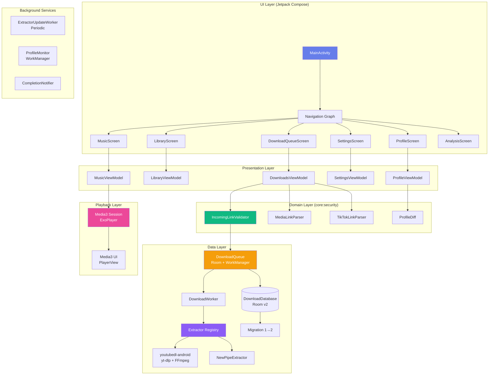
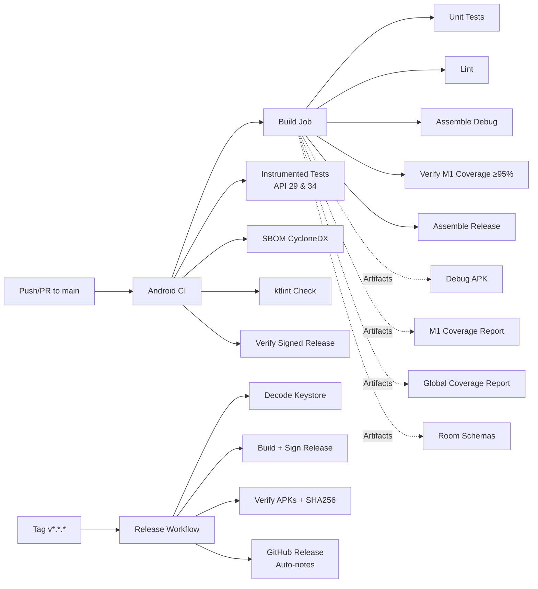

<!-- PROJECT LOGO & HEADER -->
<div align="center">
  <a href="https://github.com/cponce123com-create/Tikitoki-Dowloader">
    
  </a>

  <h1 style="margin-top: 16px; font-size: 2.5rem; font-weight: 800; background: linear-gradient(135deg, #667eea 0%, #764ba2 100%); -webkit-background-clip: text; -webkit-text-fill-color: transparent; background-clip: text;">
    Baja.pe
  </h1>

  <p style="font-size: 1.2rem; color: #6b7280; max-width: 600px; margin: 16px auto;">
    Aplicación Android nativa en <strong>Kotlin + Jetpack Compose</strong> para analizar enlaces y descargar/reproducir contenido multimedia desde plataformas compatibles.
  </p>

  <!-- BADGES -->
  <div style="margin: 24px 0;">
    <a href="https://github.com/cponce123com-create/Tikitoki-Dowloader/actions/workflows/android.yml">
      
    </a>
    <a href="https://github.com/cponce123com-create/Tikitoki-Dowloader/actions/workflows/release.yml">
      
    </a>
    <a href="https://github.com/cponce123com-create/Tikitoki-Dowloader/releases/latest">
      
    </a>
    <a href="https://github.com/cponce123com-create/Tikitoki-Dowloader/blob/main/LICENSE">
      
    </a>
    
    
    
    
    <a href="https://github.com/cponce123com-create/Tikitoki-Dowloader/security/policy">
      
    </a>
  </div>

  <!-- QUICK LINKS -->
  <div style="margin: 24px 0;">
    <a href="#-arquitectura" style="margin: 0 12px; text-decoration: none; color: #667eea; font-weight: 600;">🏗 Arquitectura</a>
    <a href="#-stack-tecnológico" style="margin: 0 12px; text-decoration: none; color: #667eea; font-weight: 600;">⚙️ Stack</a>
    <a href="#-plataformas-compatibles" style="margin: 0 12px; text-decoration: none; color: #667eea; font-weight: 600;">🌐 Plataformas</a>
    <a href="#-inicio-rápido" style="margin: 0 12px; text-decoration: none; color: #667eea; font-weight: 600;">🚀 Inicio</a>
    <a href="#-ci--cd" style="margin: 0 12px; text-decoration: none; color: #667eea; font-weight: 600;">🔄 CI/CD</a>
    <a href="#-licencia" style="margin: 0 12px; text-decoration: none; color: #667eea; font-weight: 600;">⚖️ Licencia</a>
  </div>
</div>

---

## ✨ Características Principales

<div style="display: grid; grid-template-columns: repeat(auto-fit, minmax(280px, 1fr)); gap: 16px; margin: 24px 0;">

  <details style="border: 1px solid #e5e7eb; border-radius: 12px; padding: 20px; background: #fafafa; transition: all 0.3s ease;">
    <summary style="font-weight: 700; font-size: 1.1rem; cursor: pointer; display: flex; align-items: center; gap: 8px;">
      <span style="font-size: 1.5rem;">🔗</span> Análisis de Enlaces Inteligente
    </summary>
    <div style="margin-top: 12px; color: #4b5563; line-height: 1.6;">
      <p>Validador de URLs robusto (módulo <code>core:security</code>) con <strong>95%+ cobertura de tests</strong>. Parseo de enlaces TikTok, YouTube, Instagram, Facebook, XVideos, Vimeo, Dailymotion, SoundCloud, Twitch.</p>
      <ul style="margin: 8px 0; padding-left: 20px;">
        <li>Detección automática de plataforma</li>
        <li>Extracción de metadatos (título, duración, miniatura, formatos)</li>
        <li>Selección individual/múltiple de formatos (video/audio)</li>
        <li>Descarga por lotes de las imágenes de publicaciones TikTok /photo/</li>
      </ul>
    </div>
  </details>

  <details style="border: 1px solid #e5e7eb; border-radius: 12px; padding: 20px; background: #fafafa; transition: all 0.3s ease;">
    <summary style="font-weight: 700; font-size: 1.1rem; cursor: pointer; display: flex; align-items: center; gap: 8px;">
      <span style="font-size: 1.5rem;">⬇️</span> Cola de Descargas Adaptativa
    </summary>
    <div style="margin-top: 12px; color: #4b5563; line-height: 1.6;">
      <p>Persistente y paralela con <strong>Room + WorkManager</strong>. Concurrencia dinámica según red (Wi-Fi/móvil) y estado de batería.</p>
      <ul style="margin: 8px 0; padding-left: 20px;">
        <li>Pausa, reanudación, reintentos con backoff exponencial</li>
        <li>Límites configurables por usuario</li>
        <li>Notificaciones de progreso en tiempo real</li>
        <li>Recuperación ante fallos de red/extracción</li>
      </ul>
    </div>
  </details>

  <details style="border: 1px solid #e5e7eb; border-radius: 12px; padding: 20px; background: #fafafa; transition: all 0.3s ease;">
    <summary style="font-weight: 700; font-size: 1.1rem; cursor: pointer; display: flex; align-items: center; gap: 8px;">
      <span style="font-size: 1.5rem;">📚</span> Biblioteca Local Multimedia
    </summary>
    <div style="margin-top: 12px; color: #4b5563; line-height: 1.6;">
      <p>Gestión completa de archivos descargados con reproducción integrada.</p>
      <ul style="margin: 8px 0; padding-left: 20px;">
        <li>Reproducción audio/video con <strong>Media3 (ExoPlayer)</strong></li>
        <li>Miniplayer persistente + pantalla completa</li>
        <li>Seguimiento opcional de perfiles públicos</li>
        <li>Exportación/importación de biblioteca (JSON)</li>
        <li>Estadísticas de almacenamiento y uso</li>
      </ul>
    </div>
  </details>

  <details style="border: 1px solid #e5e7eb; border-radius: 12px; padding: 20px; background: #fafafa; transition: all 0.3s ease;">
    <summary style="font-weight: 700; font-size: 1.1rem; cursor: pointer; display: flex; align-items: center; gap: 8px;">
      <span style="font-size: 1.5rem;">🔄</span> Extractor Auto-actualizable
    </summary>
    <div style="margin-top: 12px; color: #4b5563; line-height: 1.6;">
      <p>Actualización silenciosa de <strong>yt-dlp</strong> vía <code>youtubedl-android</code> con rollback automático y diagnósticos.</p>
      <ul style="margin: 8px 0; padding-left: 20px;">
        <li>Verificación de versión y prueba de humo</li>
        <li>Rollback a versión funcional ante fallo</li>
        <li>Historial de diagnósticos locales</li>
        <li>Fallback a NewPipeExtractor</li>
      </ul>
    </div>
  </details>

</div>

---

## 🏗 Arquitectura

<div align="center">



</div>

### Módulos del Proyecto

| Módulo | Responsabilidad | Cobertura Requerida |
|--------|----------------|---------------------|
| `:app` | UI, Workers, Database, Playback, Navigation | Global (sin umbral) |
| `:core:security` | **M1** - Validadores de URLs/Intents, parsers | **≥ 95% líneas** (gate en CI) |

> **M1 (core:security)** es el módulo crítico de seguridad. Valida todos los intents entrantes y URLs antes de que lleguen al extractor. Su cobertura se verifica en cada PR vía `verifyM1Coverage`.

---

## ⚙️ Stack Tecnológico

<div align="center">

| Capa | Tecnología | Versión | Propósito |
|------|------------|---------|-----------|
| **Lenguaje** |  | 2.0.21 | Lenguaje principal |
| **UI** |  | 2024.12.01 | UI declarativa + Material3 |
| **Arquitectura** |  | 2.8.7 | Estado de UI + ciclo de vida |
| **BD Local** |  | 2.7.2 | Persistencia tipo-segura |
| **Background** |  | 2.12.0 | Tareas diferidas garantizadas |
| **Reproducción** |  | 1.5.1 | Motor multimedia robusto |
| **Imágenes** |  | 2.7.0 | Carga async + video thumbnails |
| **Extracción** |  | 0.18.1 | Extractor principal (GPL-3.0) |
| **Extracción Alt.** |  | v0.27.1 | Fallback (GPL-3.0) |
| **Build** |  | 9.3.1 | Build system + KSP + ktlint |
| **Calidad** |  | 1.5.0 | Linting con baseline |
| **Tests** |  | 4.13.2 | Unit + Instrumented (API 29/34) |
| **Cobertura** |  | - | M1 ≥95% + Global report |
| **SBOM** |  | - | Inventario de dependencias |

</div>

### Requisitos de Build

- **JDK 17** (Temurin/OpenJDK)
- **Android SDK** Platform 36 + Build Tools 36.0.0
- **Gradle 9.3.1** (wrapper incluido, verifica SHA-256)
- **Linux/macOS/Windows** con ≥ 4GB RAM para CI

---

## 🌐 Plataformas Compatibles

<div align="center">

| Plataforma | Dominios | Extractor | Estado | Notas |
|------------|----------|-----------|--------|-------|
| **TikTok** | `tiktok.com`, `vm.tiktok.com`, `vt.tiktok.com` | yt-dlp + motor Kotlin de fotos | ✅ Activo | Videos y fotos públicas de carruseles /photo/ |
| **YouTube** | `youtube.com`, `youtu.be`, `music.youtube.com` | yt-dlp | ✅ Activo | Videos, Shorts, Music, playlists |
| **Instagram** | `instagram.com` | yt-dlp | ✅ Activo | Reels, posts, stories, IGTV |
| **Facebook** | `facebook.com`, `fb.watch` | yt-dlp | ✅ Activo | Videos públicos, reels |
| **XVideos** | `xvideos.com` | yt-dlp | ✅ Activo | Contenido adulto (verificar legalidad) |
| **Vimeo** | `vimeo.com` | yt-dlp | ✅ Activo | Videos públicos/privados (con acceso) |
| **Dailymotion** | `dailymotion.com` | yt-dlp | ✅ Activo | Videos, playlists |
| **SoundCloud** | `soundcloud.com` | yt-dlp | ✅ Activo | Tracks, sets, likes |
| **Twitch** | `twitch.tv`, `clips.twitch.tv` | yt-dlp | ✅ Activo | VODs, clips, highlights |

</div>

> ⚠️ **Nota legal**: La app analiza enlaces públicos. **La descarga solo está permitida para contenido propio o con autorización expresa**. No se garantiza acceso a contenido privado, protegido por DRM, geo-bloqueado o restringido por la plataforma. Consulta [PRIVACY.md](PRIVACY.md) y [SECURITY.md](SECURITY.md).

---

## 🚀 Inicio Rápido

### 1. Clonar y Configurar

```bash
# Clonar repositorio
git clone https://github.com/cponce123com-create/Tikitoki-Dowloader.git
cd Tikitoki-Dowloader

# Verificar wrapper Gradle (SHA-256 verificado en CI)
./gradlew --version
```

### 2. Build Debug (Desarrollo)

```bash
# Linux/macOS
./gradlew testDebugUnitTest lintDebug assembleDebug

# Windows
gradlew.bat testDebugUnitTest lintDebug assembleDebug
```

**APK generado**: `app/build/outputs/apk/debug/app-universal-debug.apk`

### 3. Build Release (Producción)

Requiere variables de firma configuradas:

```bash
export KEYSTORE_PATH=/ruta/keystore.jks
export KEYSTORE_PASSWORD=***
export KEY_ALIAS=***
export KEY_PASSWORD=***

./gradlew testDebugUnitTest lintDebug assembleRelease verifyM1Coverage
```

**APKs firmados**: `app/build/outputs/apk/release/` (arm64-v8a, armeabi-v7a)

#### Versionado y publicación

La fuente única de versión está en `[versions]` de `gradle/libs.versions.toml`: aumenta `appVersion` y `appVersionCode` en cada release; el código Android debe ser mayor que el de todos los tags de release anteriores. Actualiza también el `CHANGELOG.md`.

Antes de crear el tag, valida el estado local con:

```bash
git fetch --tags origin
python3 scripts/verify_release_version.py vMAJOR.MINOR.PATCH
```

Cuando las verificaciones pasen, crea y publica un tag que coincida exactamente con `appVersion`, por ejemplo `v0.5.1`. El workflow vuelve a comprobar el tag y que `appVersionCode` avance antes de firmar; no reutilices tags/versiones publicados.

### 4. Ejecutar Tests

```bash
# Tests unitarios + cobertura M1 (gate ≥95%)
./gradlew testDebugUnitTest verifyM1Coverage

# Tests instrumentados (requiere emulador/dispositivo)
./gradlew connectedDebugAndroidTest

# Cobertura global (reporte sin umbral)
./gradlew globalCoverageReport

# Lint + ktlint
./gradlew lintDebug ktlintCheck
```

### 5. Abrir en Android Studio

1. `File → Open` → Seleccionar carpeta `Tikitoki-Dowloader`
2. Esperar sincronización Gradle
3. `Run → Run 'app'` en emulador (API 29/34 recomendado) o dispositivo físico

---

## 🔄 CI / CD Pipeline

<div align="center">



</div>

### Jobs de CI

| Job | Trigger | Duración aprox. | Artifacts |
|-----|---------|-----------------|-----------|
| **build** | Push/PR main | ~8 min | Debug APK, Coverage reports, Room schemas |
| **android-instrumented** | Push/PR main | ~12 min | Test results, Screenshots (music layout/playing) |
| **sbom** | Push/PR main | ~3 min | CycloneDX BOM |
| **ktlint** | Push/PR main | ~2 min | ktlint report |
| **verify-signed-release** | Push/PR main | ~5 min | Verificación firma + no x86_64 |
| **release (publish)** | Tag `v*.*.*` | ~10 min | GitHub Release con APKs + SHA256SUMS |

### Secrets Requeridos para Release

| Secret | Descripción |
|--------|-------------|
| `KEYSTORE_BASE64` | Keystore codificado en base64 |
| `KEYSTORE_PASSWORD` | Password del keystore |
| `KEY_ALIAS` | Alias de la clave |
| `KEY_PASSWORD` | Password de la clave |

---

## 📁 Estructura del Proyecto

```
Tikitoki-Dowloader/
├── .github/
│   ├── workflows/
│   │   ├── android.yml          # CI principal
│   │   └── release.yml          # Release automático
│   └── dependabot.yml           # Actualizaciones semanales
├── app/                         # Módulo principal (:app)
│   ├── src/
│   │   ├── main/
│   │   │   ├── java/com/tikitoki/downloader/
│   │   │   │   ├── audio/       # SpectrumAnalyzer, AudioProcessor
│   │   │   │   ├── data/        # Queue, Workers, DB, Extractors, Notifications
│   │   │   │   ├── domain/      # Parsers, Validators, Models (M1)
│   │   │   │   ├── ui/          # ViewModels, Compose Screens
│   │   │   │   ├── *.kt         # Activities, Navigation, Services
│   │   │   │   └── BajaApplication.kt
│   │   │   ├── res/             # Resources, themes, drawables
│   │   │   └── AndroidManifest.xml
│   │   ├── androidTest/         # Tests instrumentados (API 29/34)
│   │   └── test/                # Tests unitarios
│   ├── build.gradle.kts         # Config + coverage gates
│   ├── ktlint-baseline.xml      # Baseline ktlint
│   └── proguard-rules.pro
├── core/
│   └── security/                # Módulo M1 (core:security)
│       └── src/main/kotlin/     # IncomingLinkValidator, MediaLinkParser, TikTokLinkParser
├── docs/
│   └── BASELINE.md              # Estado técnico de referencia
├── gradle/
│   └── libs.versions.toml       # Version catalog
├── build.gradle.kts             # Root config
├── settings.gradle.kts          # Módulos :app, :core:security
├── gradle.properties            # Config JVM + Android
├── gradlew / gradlew.bat        # Wrapper 9.3.1 (SHA-256 verificado)
├── LICENSE                      # GPL-3.0
├── NOTICE.md                    # Licencias terceros
├── PRIVACY.md                   # Política privacidad
├── SECURITY.md                  # Política seguridad
└── CHANGELOG.md                 # Historial versiones
```

---

## 🧪 Testing & Calidad

### Cobertura M1 (Obligatoria ≥95%)

```bash
# Ejecutar y verificar gate
./gradlew verifyM1Coverage

# Ver reporte HTML
open app/build/reports/jacoco/m1CoverageReport/html/index.html
```

**Clases del reporte JaCoCo**: `IncomingLinkValidator`, `MediaLinkParser`, `DownloadInputPolicy`, `MetadataSanitizer`, `TikTokLinkParser`. `IncomingIntentReader` cruza una frontera Android y se valida por separado con pruebas instrumentadas (`connectedDebugAndroidTest`); no forma parte del umbral JaCoCo unitario.

La cobertura global se verifica con `./gradlew verifyGlobalCoverage`. Su piso actual en CI es 10% de líneas, mientras se trabaja hacia la meta de 70%; las pruebas de `:app` y `:core:security` alimentan los reportes JaCoCo.

### Tests Instrumentados

- Ejecutados en emulador API 29 y 34 (matriz)
- Cubren: navegación, cola de descargas, reproducción, intents entrantes
- Capturas de pantalla: `music-layout.png`, `music-playing.png`

### Linting

```bash
# Verificar estilo (baseline en ktlint-baseline.xml)
./gradlew ktlintCheck

# Auto-fix (cuando sea posible)
./gradlew ktlintFormat
```

### SBOM (Software Bill of Materials)

```bash
./gradlew cyclonedxBom
# Output: build/reports/cyclonedx/bom.json
```

---

## 📦 Distribución

| Canal | Estado | Notas |
|-------|--------|-------|
| **GitHub Releases** | 🎯 Primario | APKs firmados por ABI + SHA256SUMS |
| **F-Droid** | 🔄 Planeado | Requiere revisión de licencias GPL |
| **IzzyOnDroid** | 🔄 Planeado | Repositorio alternativo F-Droid |
| **Google Play** | ❌ No planeado | Políticas de extracción de contenido |

### Verificar Release

```bash
# Verificar firma APK
apksigner verify --print-certs app/build/outputs/apk/release/app-arm64-v8a-release.apk

# Verificar SHA256
sha256sum -c SHA256SUMS.txt
```

---

## 🤝 Contribuir

1. **Fork** → Crear rama `feat/`, `fix/`, `docs/`, `refactor/`
2. **Commits convencionales**: `feat: añadir soporte X`, `fix: corregir Y en Z`
3. **PR a `main`** → CI debe pasar (tests, lint, coverage M1 ≥95%)
4. **Code review** → Al menos 1 aprobación
5. **Merge** → Squash + delete branch

### Guías

- [Convención de commits](https://www.conventionalcommits.org/)
- [Estilo Kotlin](https://kotlinlang.org/docs/coding-conventions.html) + ktlint baseline
- **Nunca** subas keystores, passwords, tokens o datos personales
- Tests nuevos para features/fixes; mantener cobertura M1

---

## 📄 Licencia

<div align="center">

**GPL-3.0-or-later** — Ver [LICENSE](LICENSE) para texto completo.

[](https://www.gnu.org/licenses/gpl-3.0.html)

</div>

### Resumen de Obligaciones GPL-3.0

| Requisito | Acción |
|-----------|--------|
| **Código fuente** | Distribuir o linkear código correspondiente al binario |
| **Licencias preservadas** | Mantener avisos de copyright y licencia en todos los archivos |
| **Instalación** | Proveer instrucciones para compilar/instalar versión modificada |
| **Estado de cambios** | Documentar modificaciones en archivos cambiados |
| **Obras derivadas** | Licenciar toda la obra derivada bajo GPL-3.0 |

> **Componentes GPL-3.0 transitivos**: `youtubedl-android`, `NewPipeExtractor`. Ver [NOTICE.md](NOTICE.md) para inventario completo.

---

## 🔗 Enlaces Útiles

<div align="center">

| Recurso | Enlace |
|---------|--------|
| **Issues / Bugs** | [GitHub Issues](https://github.com/cponce123com-create/Tikitoki-Dowloader/issues) |
| **Security Advisory** | [Private Reporting](https://github.com/cponce123com-create/Tikitoki-Dowloader/security/advisories/new) |
| **Releases / APKs** | [GitHub Releases](https://github.com/cponce123com-create/Tikitoki-Dowloader/releases) |
| **Actions / CI Logs** | [GitHub Actions](https://github.com/cponce123com-create/Tikitoki-Dowloader/actions) |
| **Dependabot Alerts** | [Security Alerts](https://github.com/cponce123com-create/Tikitoki-Dowloader/security/dependabot) |
| **Wiki / Docs** | [GitHub Wiki](https://github.com/cponce123com-create/Tikitoki-Dowloader/wiki) |

</div>

---

<div align="center" style="margin-top: 48px; padding: 24px; background: linear-gradient(135deg, #f3f4f6 0%, #e5e7eb 100%); border-radius: 16px;">

### ⭐ ¿Te gusta el proyecto?

**¡Dale una estrella en GitHub y compártelo!**

[](https://github.com/cponce123com-create/Tikitoki-Dowloader/stargazers)
[](https://github.com/cponce123com-create/Tikitoki-Dowloader/network/members)
[](https://github.com/cponce123com-create/Tikitoki-Dowloader/watchers)

---

**Desarrollado con ❤️ usando Kotlin, Compose y la potencia de yt-dlp**

*Última actualización: 2025 — Versión 0.5.0*

</div>
