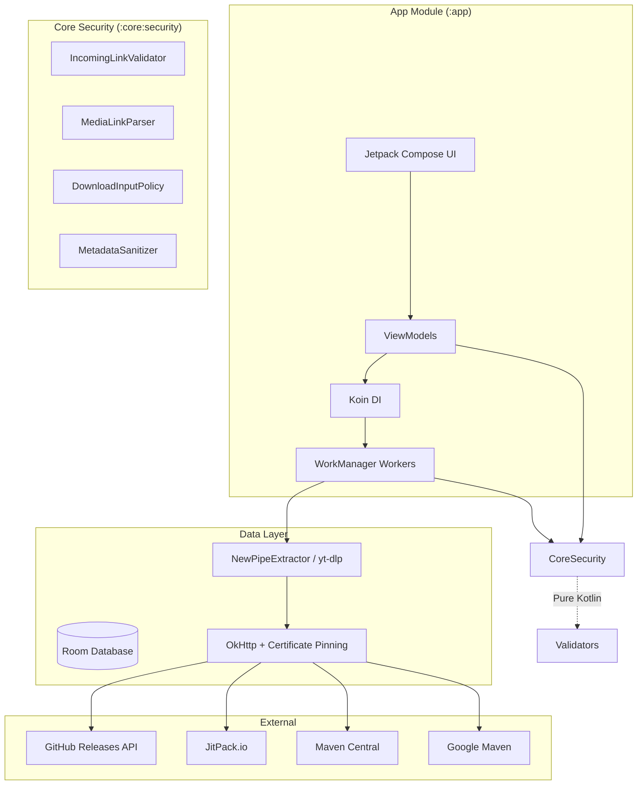
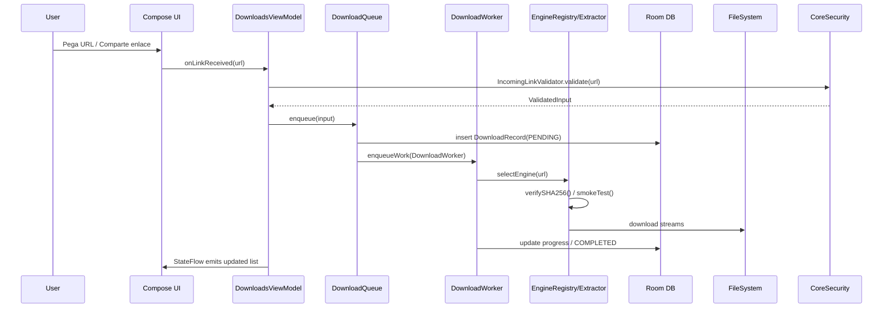

# Arquitectura de Tikitoki-Downloader (Baja.pe)

> Documento vivo que describe la arquitectura actual y el plan de modularización incremental. Actualizar con cada cambio estructural significativo.

---

## Visión General

Tikitoki-Downloader (Baja.pe) es una aplicación Android para descargar contenido multimedia (video, audio, imágenes) de múltiples plataformas. La arquitectura prioriza:

- **Seguridad**: Validación estricta de entradas, certificate pinning, verificación SHA-256 de binarios
- **Modularidad**: Separación clara entre UI, dominio, datos y seguridad
- **Testabilidad**: Cobertura ≥95% en lógica de seguridad (`core:security`), ≥70% global
- **Cumplimiento GPL-3.0**: NOTICE, LICENSE, SBOM, source availability verificados en CI

---

## Diagrama de Alto Nivel



---

## Módulos Actuales

### `:app` — Punto de Entrada y Composición
- **Responsabilidad**: Inicialización (Application), navegación, pantalla principal, DI container
- **Tecnologías**: Jetpack Compose, Material3, Koin 4.x, WorkManager, Media3/ExoPlayer
- **Dependencias**: `:core:security`, extractores, Room, Coil, AndroidX
- **Puntos de Entrada**: `BajaApplication`, `MainActivity`, `MainNavigationBar`

### `:core:security` — Validación y Políticas (Puro Kotlin/JVM)
- **Responsabilidad**: Lógica de validación de URLs, parsing de metadatos, políticas de entrada
- **Sin dependencias Android** — Compila como biblioteca JVM estándar
- **Cobertura obligatoria**: ≥95% (gate `verifyM1Coverage` en CI)
- **Componentes**:
  - `IncomingLinkValidator` — Valida intents entrantes y deep links
  - `MediaLinkParser` — Extrae metadatos normalizados de URLs
  - `DownloadInputPolicy` — Políticas de formato, calidad, destino
  - `MetadataSanitizer` — Limpia metadatos antes de persistir

---

## Capa de Datos (en `:app`)

### Repositorios y Fuentes
| Componente | Responsabilidad |
|------------|-----------------|
| `DownloadDatabase` | Room DAO + entities para descargas, historial, ajustes |
| `DownloadQueue` | Cola en memoria con persistencia, prioridades, reintentos |
| `EngineRegistry` | Registro de extractores disponibles (NewPipe, yt-dlp) |
| `ExtractorAccess` | Facade para acceso a extractores con recuperación automática |
| `ExtractorRecovery` | Rollback automático si verificación SHA-256 falla |
| `ExtractorVerifier` | Verifica hash SHA-256 de yt-dlp contra GitHub Releases |

### Workers (WorkManager)
| Worker | Disparador | Función |
|--------|------------|---------|
| `DownloadWorker` | Cola de descargas | Ejecuta descarga con extractor seleccionado |
| `ExtractorUpdateWorker` | Periódico (24h) | Verifica actualizaciones de extractores, smoke test + SHA-256 |

### Seguridad de Red
- **Certificate Pinning**: `network_security_config.xml` separa los pin-sets por proveedor y mantiene una clave primaria y otra de respaldo por dominio
- **Extraction Verification**: SHA-256 del ejecutable empaquetado fijado por versión; versiones desconocidas se rechazan y activan rollback
- **Rollback Automático**: Si verificación falla → `ExtractorRollback` restaura versión anterior

---

## Patrones de Arquitectura

### Inyección de Dependencias (Koin)
```kotlin
// di/AppModule.kt
val appModule = module {
    viewModel { DownloadsViewModel(get()) }
    viewModel { ProfileViewModel(get()) }
    single { DownloadDatabase(get()) }
    single { DownloadQueue(get(), get(), get()) }
    // ... workers scoped to Worker context
}
```
- **ViewModels**: `viewModel { }` — scope de navegación
- **Repositorios/Servicios**: `single { }` — singleton por proceso
- **Workers**: `scope<Worker> { scoped { } }` — scope de WorkManager

### ViewModels
- **DownloadsViewModel**: Estado de cola, filtros, acciones de descarga
- **ProfileViewModel**: Inspección de perfiles/URLs, paginación, avatares
- Ambos heredan de `AndroidViewModel` para acceso a `Application`

### Estado de UI
- `StateFlow` / `MutableStateFlow` para estado reactivo
- `stateIn(SharingStarted.WhileSubscribed())` para compartir en Compose
- Unidireccional: Eventos → ViewModel → StateFlow → Compose

---

## Flujo de Descarga



---

## Configuración de Calidad (Quality Gates)

| Gate | Comando | Umbral | Ubicación |
|------|---------|--------|-----------|
| M1 Security Coverage | `verifyM1Coverage` | ≥95% LINE | `:core:security` |
| Global Coverage | `verifyGlobalCoverage` | ≥70% LINE | `:app` + `:core:security` |
| Lint | `lintDebug` | 0 errors | `:app` |
| Ktlint | `ktlintCheck` | Baseline | `:app` |
| Detekt | `detektCheck` | 0 findings | `:app` |
| License Compliance | `license-compliance.yml` | PASS | CI |
| Dependency Check | `dependency-check.yml` | CVSS<7 | CI |
| SBOM | `cyclonedxBom` | Generated | CI |

---

## Plan de Modularización Incremental

### Fase 1: Extracción de Dominio (Próximo)
- [ ] Crear `:core:domain` — Contratos puros (interfaces, modelos, casos de uso)
- [ ] Mover `DownloadQueueActions`, `MediaLink`, `LinkParseResult` a domain
- [ ] `:app` y `:core:security` dependen de `:core:domain`
- [ ] Gate: Compila, tests pasan, no ciclos de dependencia

### Fase 2: Capa de Datos Compartida
- [ ] Crear `:core:data` — Room DAO, Repository interfaces, DataSources
- [ ] Extraer `DownloadDatabase`, `DownloadQueue` (interface), `EngineRegistry`
- [ ] `:app` implementa `DownloadQueue` concreto
- [ ] Gate: Tests de integración Room en `:core:data`

### Fase 3: Features como Módulos
- [ ] `:feature:downloads` — Descargas, cola, UI de descargas, `DownloadsViewModel`
- [ ] `:feature:library` — Biblioteca, reproductor, `ProfileViewModel`, `LibraryScreen`
- [ ] `:feature:settings` — Ajustes, apariencia, diagnósticos
- [ ] Cada feature: Android Library con su propio `build.gradle.kts`

### Fase 4: Red y Utilidades Comunes
- [ ] `:core:network` — OkHttp client configurado, certificate pinning, interceptors
- [ ] `:core:util` — Extensiones, helpers, logging común

### Fase 5: App Shell Delgado
- [ ] `:app` solo: `BajaApplication`, `MainActivity`, navegación raíz, Koin bootstrap
- [ ] `MainActivity` < 500 líneas (actual ~2500)
- [ ] Navigation Graph composeado desde features

---

## Criterios de Extracción

Antes de crear un nuevo módulo:
1. ✅ Responsabilidad única bien definida
2. ✅ Interfaces/contratos en domain, implementaciones en data/feature
3. ✅ Sin dependencias circulares (verificar con `gradle dependencyInsight`)
4. ✅ Tests unitarios pasan en el módulo aislado
5. ✅ Tests de integración pasan en `:app`
6. ✅ Lint/Detekt/Ktlint limpios
7. ✅ Documentación actualizada en este archivo

---

## Decisiones Técnicas Clave

| Decisión | Justificación | Alternativas Consideradas |
|----------|---------------|---------------------------|
| Koin vs Hilt vs Dagger | Koin: puro Kotlin, sin annotation processing, DSL simple, 4.0.0 estable | Hilt (más boilerplate), Dagger (complejo) |
| WorkManager para descargas | Persistencia garantizada, constraints (red, carga), retry nativo | Foreground Service + custom queue |
| NewPipeExtractor + yt-dlp | Cobertura máxima de sitios, GPL-3.0 compatible | Solo uno (cobertura limitada) |
| Certificate Pinning | MitM prevention en actualizaciones críticas | TrustManager default (menos seguro) |
| SHA-256 verification | Supply-chain attack mitigation | Sin verificación (riesgo alto) |
| ABI splits (arm64/armeabi) | x86_64 solo emuladores, -25% APK | Universal APK (más grande) |
| Density splits | Solo densidades necesarias | Sin splits (APK +15-20%) |
| Baseline Profiles | Startup + frame rendering optimizado | Sin perfiles (cold start más lento) |
| Compose Compiler Daemon | Builds incrementales más rápidos | Sin daemon (builds más lentos) |

---

## Referencias Rápidas

### Comandos Útiles
```bash
# Verificar cobertura M1
./gradlew verifyM1Coverage

# Verificar cobertura global
./gradlew verifyGlobalCoverage

# Lint + Tests + Build debug
./gradlew lintDebug testDebugUnitTest assembleDebug

# Generar SBOM
./gradlew cyclonedxBom

# Formatear código (ktlint)
./gradlew ktlintFormat

# Análisis estático
./gradlew detektCheck

# Ver grafo de dependencias
./gradlew :app:dependencies --configuration debugRuntimeClasspath
```

### Archivos Clave
| Archivo | Descripción |
|---------|-------------|
| `gradle/libs.versions.toml` | Catálogo de versiones centralizado |
| `app/build.gradle.kts` | Configuración app, tasks de cobertura |
| `core/security/build.gradle.kts` | Configuración módulo seguridad |
| `app/src/main/java/.../di/AppModule.kt` | Módulo Koin |
| `app/src/main/res/xml/network_security_config.xml` | Certificate pinning |
| `.github/workflows/android.yml` | CI principal |
| `.github/workflows/license-compliance.yml` | GPL-3.0 compliance |
| `.github/workflows/dependency-check.yml` | OWASP CVE scanning |

---

## Historial de Cambios Significativos

| Fecha | Cambio | Commit |
|-------|--------|--------|
| 2026-11 | Koin DI, MockK, Turbine, Global Coverage 70% | `feat(di): add Koin dependency injection framework` |
| 2026-10 | Certificate pinning, SHA-256 verification, rollback | `R1-R3 security hardening` |
| 2026-10 | Version catalog, CI matrix API 26-35, Detekt, Dependabot | `R4-R7 modernization` |
| 2026-10 | GPL-3.0 compliance automation (NOTICE, LICENSE, SBOM) | `R2 license compliance` |
| 2026-09 | Room, WorkManager, Media3, Compose migration | `feat: modern android stack` |

---

*Última actualización: 2026-11-17 — Mantener este documento sincronizado con la realidad del código.*
